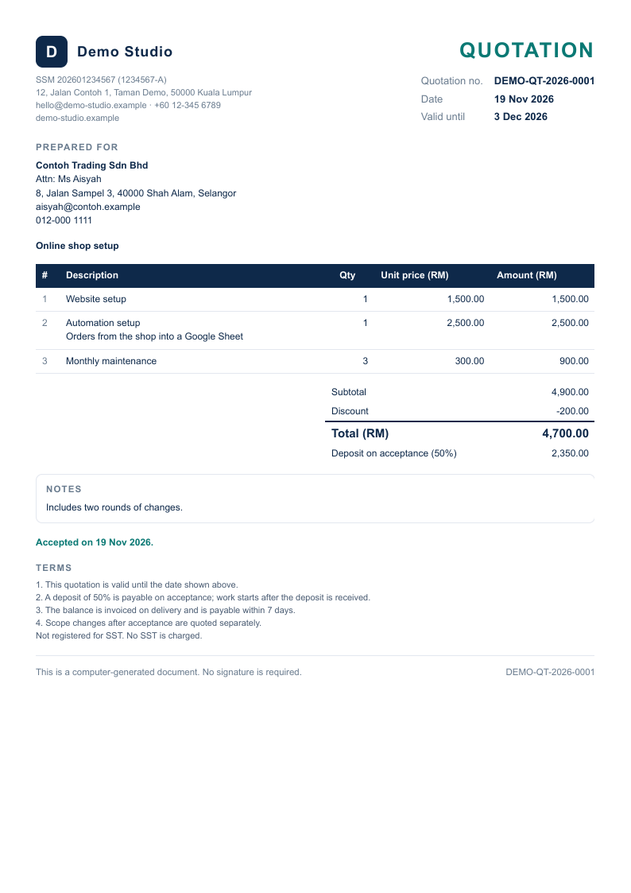
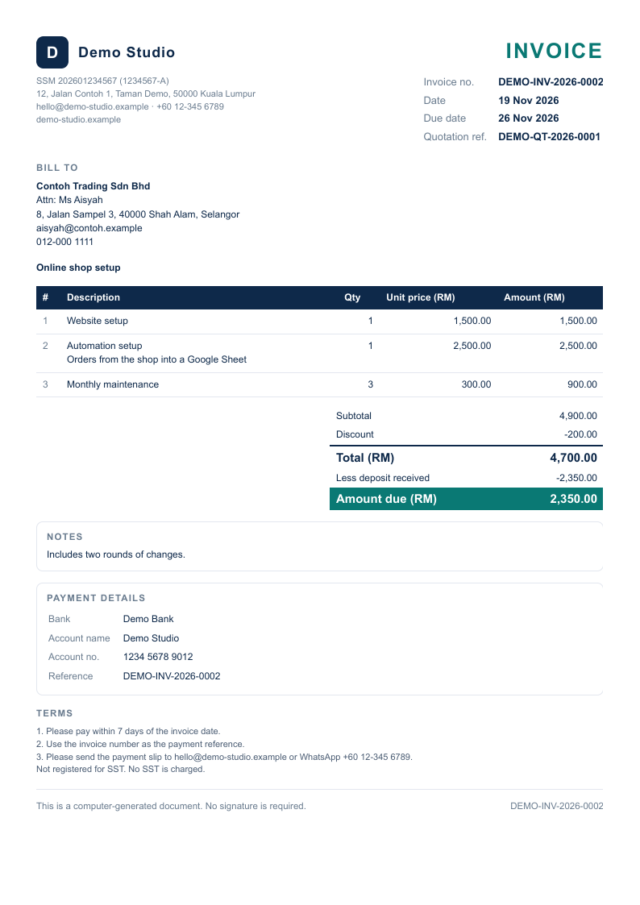
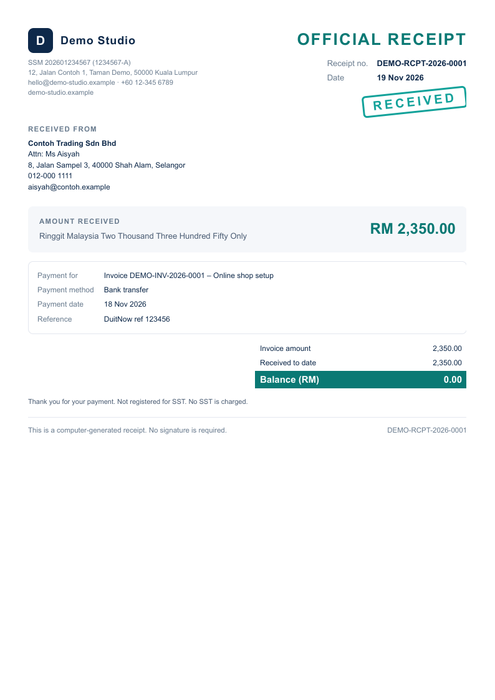
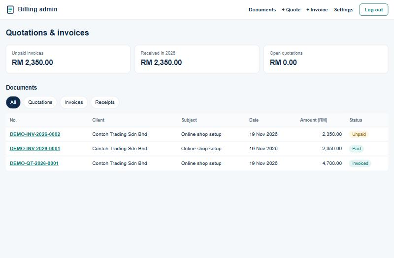
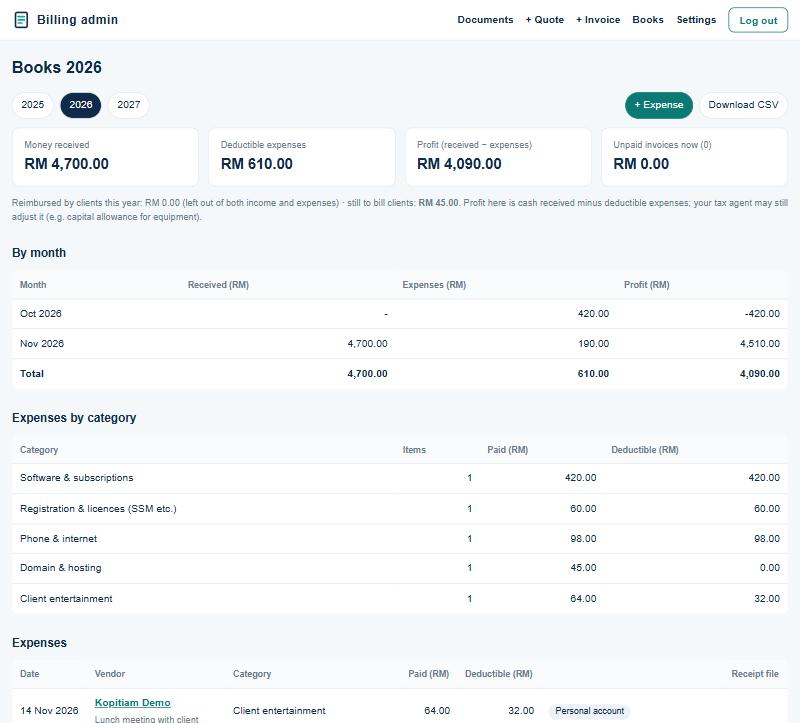

# Comanta Billing

Quotations, invoices and official receipts for small Malaysian businesses, running on **Cloudflare Workers + D1**.
No server to rent, no monthly fee on the free plan, and no customer data in someone else's SaaS.

Built for and used by [COMANTA SOLUTIONS](https://comanta.com.my), a sole proprietorship in Malaysia, to bill its first clients. Released under the MIT licence.

| Quotation | Invoice | Official receipt |
|---|---|---|
|  |  |  |

| Documents | Books |
|---|---|
|  |  |

*All names, numbers and addresses in the screenshots are made up.*

## What it does

- **Quotation → deposit invoice → balance invoice → receipt**, with the client accepting the quotation online (they type their name and press *Accept*).
- **Client links** (`/d/<random-token>`): the client opens the document in a browser and saves it as a one-page A4 PDF. Drafts are never visible.
- **Numbering** per year and document type: `QT-2026-0001`, `INV-2026-0001`, `RCPT-2026-0001`, with an optional prefix (`ACME-INV-2026-0001`). Numbers come from a counter in the database, so they never repeat.
- **Monthly services**: one click on *Next month's invoice* copies the client and items with every date moved a month on.
- **Payments**: record full or part payments; advance payments made before the invoice date are shown as *Advance received*.
- **Books**: money received (by the date it arrived), business expenses by category, profit per month, unpaid invoices, and a CSV for your accountant. Client entertainment counts 50%; expenses a client pays back are kept but left out of both income and expenses.
- **Official receipts** for money already recorded, with the amount in words (*Ringgit Malaysia Five Hundred Only*) and the balance left on the invoice.
- **Owner-only admin** at `/admin`, with a 6-digit login code sent to the owner's email. No passwords are stored.
- **Daily backup by email**: every night the whole database (documents, receipts, clients, numbering, settings) is emailed to you as a `.sql` attachment that restores into an empty database.
- **Command-line tool** for the same data (`tools/billing.mjs`): create, send, invoice, record payments, issue receipts, export PDFs and an `income.csv` for your tax return. Handy for scripts and AI assistants.
- English documents, amounts in RM, "Not registered for SST" note, client TIN field for when a client asks for an e-Invoice.

## How it works

```
Browser (you)  ──/admin──►  Cloudflare Worker  ──►  D1 (SQLite): settings, clients, docs, receipts, payments, expenses, counters
Browser (client) ─/d/<token>─►     │
                                   ├─ Email Routing: login codes, "quotation accepted", daily backup
                                   └─ Cron (13:00 UTC): daily backup
Your computer: tools/billing.mjs ──wrangler──► same D1 database; Chrome prints the PDFs
```

The documents are plain HTML with print styles (`src/billing-core.js`), shared by the Worker and the command-line tool, so a printed PDF and the client's view always match.

## Set it up

You need a Cloudflare account (the free plan is enough), a domain on Cloudflare with **Email Routing** turned on, and Node.js 20+.

1. **Get the code**
   ```bash
   git clone https://github.com/programmermars/comanta-billing.git
   cd comanta-billing
   npm install
   npx wrangler login
   ```
2. **Create the database** and paste the `database_id` it prints into `wrangler.jsonc`:
   ```bash
   npx wrangler d1 create billing-db
   npm run db:init
   ```
3. **Email**: in the Cloudflare dashboard → your domain → *Email* → *Email Routing*, add your own address as a **verified destination**. Then edit `wrangler.jsonc`:
   - `SITE_URL`: where the app will live, e.g. `https://billing.yourdomain.com`
   - `OWNER_EMAIL` and the `send_email` destination: your verified address
   - `MAIL_FROM`: any address on the Email Routing domain, e.g. `billing@yourdomain.com`
   - optional `routes` block to use your own domain
4. **Deploy**
   ```bash
   npm run deploy
   ```
5. Open `SITE_URL/admin`, press **Email me a login code**, then go to **Settings** and fill in your business name, SSM number, address, bank account and terms. Set the **number prefix** now if you want one; changing it halfway through a year breaks the sequence.

### Try it locally first

```bash
npm run db:init:local
npm run dev            # http://localhost:8787/admin — the login code is shown on screen in local mode
```

## Day-to-day use

**In the browser:** `+ Quote` → fill in the client and items (start typing to pick from the price list in `CATALOG`) → *Create* → check the draft → *Mark as sent* → copy the link or press *WhatsApp* / *Email*. When the client accepts, you get an email; press *Create deposit invoice*. When money arrives, *Record payment* (tick *also issue receipt* if you want one). Add business expenses under **Books → + Expense**; the Books page shows profit per month and *Download CSV* gives your accountant everything for the year.

**From the command line** (works on the live database; add `--local` for the local one):

```bash
node tools/billing.mjs new quote doc.json      # draft; see the JSON format at the top of the file
node tools/billing.mjs send qt-2026-1          # short numbers work
node tools/billing.mjs invoice qt-2026-1 deposit
node tools/billing.mjs paid inv-2026-1 2350 2026-11-18 "DuitNow ref 123456"
node tools/billing.mjs receipt inv-2026-1
node tools/billing.mjs repeat inv-2026-1           # next month's invoice for a monthly service
node tools/billing.mjs list
node tools/billing.mjs expense add exp.json    # a business expense; format at the top of the file
node tools/billing.mjs books 2026              # received, expenses and profit per month
node tools/billing.mjs sync                    # backup + PDFs + income.csv + expenses.csv into ./exports
```

Set `BILLING_EXPORT_DIR` to a folder synced by Google Drive or OneDrive to keep the PDFs in the cloud. PDFs need Chrome or Edge (`CHROME_PATH` if it is not in the usual place).

## Backups and restore

You get three layers:

1. **Daily email** (cron in `wrangler.jsonc`) with `billing-db_YYYY-MM-DD.sql`, plus an *Email a backup now* button in Settings. Login codes and sessions are left out.
2. **`node tools/billing.mjs backup`** (also run by `sync`): the same database exported by wrangler into `exports/backups`, last 90 days kept, plus `latest-numbers.txt`.
3. **D1 Time Travel**: Cloudflare can roll the database back to any minute in the last few days (`npx wrangler d1 time-travel`).

To restore a backup file, test it on a local database first, then import it into an **empty** database:

```bash
npx wrangler d1 execute billing-db --local --persist-to ./restore-test --file=billing-db_2026-11-19.sql
npx wrangler d1 execute billing-db --remote --file=billing-db_2026-11-19.sql   # into an empty database only
```

After a restore, check that each counter is not lower than the last number issued, or you will issue a duplicate number.

## Security

- `/admin` needs a login code that only goes to `OWNER_EMAIL`. Codes last 10 minutes, allow 5 tries, and at most 5 codes are sent per hour. Sessions last 30 days in an `HttpOnly; Secure; SameSite=Strict` cookie and only their SHA-256 hash is stored.
- Every form post checks the `Origin` header against `SITE_URL`.
- Client links use 18 random bytes; pages are `noindex` and not cached. Anyone with a link can see that one document, so share links only with the client.
- Backups contain client and bank details. Keep them in your own mailbox or drive.
- `LOCAL_DEV` (set only by `npm run dev`) shows login codes on screen and relaxes the origin check. Never set it in production.

## Limits

- Ringgit only, English documents, Malaysian date and SST wording.
- Books are cash-based (income when the money arrives) and do not replace an accountant; equipment still needs capital allowance worked out separately.
- No tax calculation: for businesses that are not registered for SST. Adding a tax line is a small change in `calc()` and `renderDoc()`.
- No LHDN MyInvois submission. Below the e-Invoice threshold you only issue one when a client asks; use the MyInvois portal for that.
- One owner per deployment.

## Project layout

```
src/index.js          Worker entry: routes and the daily cron
src/billing.js        admin pages, login, client view, actions
src/books.js          Books: payments, expenses, monthly profit, CSV
src/billing-core.js   money, dates, numbering and the printable documents (shared with the CLI)
src/backup.js         SQL dump + backup email
src/notify.js         email to the owner
schema.sql            tables and placeholder settings
tools/billing.mjs     command-line tool
tools/smoke-test.mjs  checks for the shared code: npm run check
```

## 中文简介

给马来西亚小生意的报价单、发票、正式收据系统，跑在 Cloudflare Workers + D1 上（免费版就够用）。功能：报价单在线接受、订金和尾款发票、记录收款、正式收据（含英文大写金额）、客户专属链接与一页 A4 PDF、按年自动编号、记账（收入、开销分类、每月利润、导出 CSV 给会计）、管理后台用邮箱验证码登录、每天自动把完整资料库备份寄到你的邮箱。设定步骤见上面的 *Set it up*。

## Licence

[MIT](LICENSE) © 2026 COMANTA SOLUTIONS
